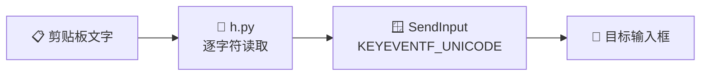

<div align="center">

# 📋 剪贴板自动输入工具

**学习通禁止粘贴？让它替你把字一个个敲进去**

[](https://www.python.org/)
[](#-常见问题)
[](LICENSE)
[](https://github.com/whaha4/xuexitong-paste-helper/stargazers)

[✨ 特性](#-特性) · [🚀 快速开始](#-快速开始) · [⌨️ 快捷键](#️-快捷键) · [❓ 常见问题](#-常见问题) · [🧠 工作原理](#-工作原理)

</div>

---

## 💡 为什么需要它

很多在线平台（学习通/超星、部分作业与考试系统）会拦截 `Ctrl+V`，但网页无法区分「真实键盘输入」和「程序模拟的按键」。本工具正是利用这一点，把剪贴板里的文字**一个字一个字敲进去**。

| 输入方式 | 禁止粘贴的输入框 | 手会不会累 |
| :--- | :---: | :---: |
| `Ctrl+V` 直接粘贴 | ❌ 被网页拦截 | 😌 |
| 手动逐字输入 | ✅ 可以输入 | 😫 会废 |
| **本工具** | ✅ 自动逐字输入 | 😎 不会 |

## ✨ 特性

- 🎯 **绕过粘贴限制** —— 不调用剪贴板粘贴，而是通过 Windows `SendInput` 逐字符发送键盘事件
- 🈶 **完整中文支持** —— Unicode 直发，不依赖输入法，中文不会变乱码
- 🎭 **emoji / 生僻字** —— 正确拆解 UTF-16 代理对，各种字符都能输出
- ⌨️ **格式还原** —— 换行自动转回车，Tab 原样保留
- 🛑 **随时中断** —— 按 `F12` 立即停止，不用等整段打完
- 🔒 **热键防污染** —— 开始前等待 `Ctrl` / `Alt` 释放，不会把修饰键打进正文
- 🧵 **单实例保护** —— 输入过程中重复触发热键，不会重复开线程

## 🚀 快速开始

> **环境要求：** Windows 10 / 11 + Python 3.8+

**1️⃣ 安装依赖**

```bash
pip install keyboard pyperclip
```

<details>
<summary>💡 pip 不是内部命令？点这里</summary>

```bash
python -m pip install keyboard pyperclip
```

</details>

**2️⃣ 运行脚本**

```bash
python h.py
```

看到下面这行提示就说明启动成功：

```text
脚本运行中：Ctrl+Alt+V 开始输入，F12 停止，Ctrl+C 退出
```

**3️⃣ 开始输入**

| 步骤 | 操作 |
| :---: | :--- |
| 1️⃣ | 复制要输入的文字（`Ctrl+C`） |
| 2️⃣ | 用鼠标点击网页里**禁止粘贴的输入框**，把光标放进去 |
| 3️⃣ | 按下 `Ctrl+Alt+V`，脚本开始逐字输入 |
| 🛑 | 需要中断时按 `F12` |
| 🚪 | 结束整个脚本：在命令行窗口按 `Ctrl+C` |

## ⌨️ 快捷键

| 快捷键 | 作用 |
| :---: | :--- |
| `Ctrl` + `Alt` + `V` | 开始输入剪贴板内容 |
| `F12` | 停止当前输入 |
| `Ctrl` + `C` | 退出脚本（需在命令行窗口内按） |

> 💻 笔记本上如果 `F12` 是媒体功能键，需要按 `Fn + F12`。

## ⚙️ 配置

调整 `h.py` 开头的参数即可：

| 参数 | 默认值 | 说明 |
| :--- | :---: | :--- |
| `DELAY` | `0.03` | 每个字符的间隔（秒）。网站反应慢或出现漏字时，调大到 `0.05` ~ `0.1` |
| `HOTKEY_RELEASE_TIMEOUT` | `1.0` | 等待 `Ctrl` / `Alt` 释放的最长时间（秒） |

## 🧠 工作原理



脚本通过 Python 的 `ctypes` 调用 Windows [`SendInput`](https://learn.microsoft.com/windows/win32/api/winuser/nf-winuser-sendinput) 接口，以 `KEYEVENTF_UNICODE` 标志直接发送字符的 UTF-16 码元。对目标网页来说，这和用户真的在键盘上敲字没有区别，因此完全绕开了复制 / 粘贴事件的拦截。

## ❓ 常见问题

<details>
<summary><b>Q：按了 <code>Ctrl+Alt+V</code> 没反应？</b></summary>

<br>

- 确认命令行窗口显示脚本正在运行；
- 确认光标确实停在可编辑的输入框内；
- 如果浏览器或其他目标程序是**以管理员身份运行**的，Windows 会阻止普通程序向它发送按键，此时请同样**以管理员身份运行本脚本**。

</details>

<details>
<summary><b>Q：中文打出来是乱码 / 打不出来？</b></summary>

<br>

脚本不依赖输入法，中文是以 Unicode 码点直接发送的。如果目标程序对输入做了特殊处理，可先点击目标窗口使其获得焦点，再触发热键重试。

</details>

<details>
<summary><b>Q：输入中途丢字？</b></summary>

<br>

把 `DELAY` 调大，例如 `0.05` 或 `0.1`。部分富文本编辑器需要更长的处理时间。

</details>

<details>
<summary><b>Q：可以在游戏 / 远程桌面里用吗？</b></summary>

<br>

部分游戏反作弊或受保护的窗口会忽略 `SendInput`，这类场景无法保证生效。

</details>

<details>
<summary><b>Q：文本太长怎么办？</b></summary>

<br>

脚本会不停顿地逐字输入，期间请不要切换窗口或操作鼠标键盘。较长文本建议分段复制、分段触发，或按 `F12` 中断后重新开始。

</details>

<details>
<summary><b>Q：支持 macOS / Linux 吗？</b></summary>

<br>

不支持。脚本直接调用 Win32 API（`SendInput`），仅能在 Windows 上运行。

</details>

## ⚠️ 使用提醒

- 输入过程中不要切换窗口或抢键盘，否则字符可能打到别处；
- 目标程序以管理员运行时，脚本也需要管理员权限；
- 本工具仅用于提高文本录入效率，请遵守所使用平台的服务条款，**切勿用于考试作弊等违规行为**。

## 📄 License

本项目基于 [MIT License](LICENSE) 开源。

---

<div align="center">

**如果这个项目帮到了你，点个 ⭐ Star 支持一下吧！**

Made with ❤️ by [whaha4](https://github.com/whaha4)

</div>
